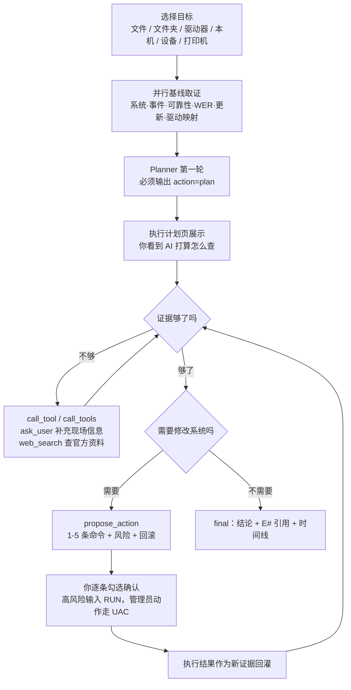

# Windows Helper Plus

[English](README_EN.md) | 简体中文

**让 AI 诊断 Windows，但每一条结论都必须带证据编号，每一次修改都必须你亲手确认。**


---

## 这个项目想解决什么

Windows 出问题时，现在只有两条路：

**一条是猜。** 蓝屏代码抄进搜索引擎，翻到第五页有人说"重装系统"，然后你重装了，问题还在。
**另一条是把电脑交给一个"一键修复"工具。** 它不知道你的驱动是哪个版本、事件日志里报了什么、最近装了什么更新，但它很敢删注册表。

这两条路的共同问题是：**没有证据链。**

Windows Helper Plus 的做法不一样。它是一个原生 Qt 桌面程序，把 DeepSeek 推理模型接上 24 个只读取证工具，让 AI 像工程师一样排查：先看现场，再提假设，再验证，最后才动手。所有结论必须引用真实证据 `E#`；所有修改必须先给你看命令、等你勾选确认。

它不是"AI 帮你修电脑"，而是**"AI 帮你查案，你自己决定要不要动手"**。

## 和"把蓝屏代码丢给聊天机器人"的区别

| | 直接问 AI | 本工具 |
| --- | --- | --- |
| 信息来源 | 你口述的那点信息 | 系统/事件/可靠性/WER/更新/驱动/转储，24 个工具实采 |
| 结论依据 | 自由发挥 | 强制绑定 `E#` 证据，编造的证据 ID 会被拒绝并要求修正 |
| 排查方式 | 一次性给答案 | 计划先行 → 多轮取证 → 证据不足就回头补，没有步数上限 |
| 动手之前 | 它直接告诉你敲什么命令 | `propose_action` 提案 → UI 逐条列出命令/风险/回滚 → 你确认 |
| 改坏了 | 无 | 动作前自动备份，设置里一键还原 |

## 一次诊断是怎么走的



整个循环**没有步数上限**，也不发送 `max_tokens`；服务端单次输出被截断时会自动续写 JSON，不会因为一次长度限制就把整轮判死。

## 核心能力

### 取证：24 个只读工具，覆盖到能真正定位问题的深度

系统信息、文件/目录/项目清单、事件日志、可靠性记录、WER 报告、更新历史、驱动枚举（PnPUtil）、签名校验（SignTool）、SetupAPI 日志、设备/打印机/网络适配器、SFC/DISM 只读扫描、`wevtutil` 查询、网页检索。

外加一组 `extended_diagnostics`（高级十法）：真实打印队列、PnP 设备树、PE 依赖分析、CBS 日志、崩溃转储、文件占用进程、还原点、性能计数、网络连通性、沙箱可行性评估。

**PE 依赖分析**会返回目标架构、版本资源、每个 DLL 的 `dll_checks`，并把异常分成缺失 / 架构不兼容 / 版本信息缺失三类。32 位目标优先解析 `SysWOW64`，`api-ms-win-*` 这类 API Set 不会被误报为缺失——这是很多工具会翻车的地方。

### 崩溃转储：真的调 `cdb.exe`，不是"建议你装个分析工具"

指定或自动发现 `.dmp`（`MEMORY.DMP`、`Minidump`、`LiveKernelReports`、WER 队列、`CrashDumps`），离线执行 `!analyze -v`，返回 `bugcheck_code`、`probably_caused_by`、调用栈、`failure_bucket_id`、WHEA 相关信息。

分析全程在本机完成，dump 不上传；只在启用符号下载时向微软请求符号文件。没装 Debugging Tools 时工具不编结果，直接告诉你缺什么。

### 修复：先备份，再动手，随时能退

- AI 提出修改/删除/替换时，必须在动作里声明 `backup_paths`（最多 8 个绝对路径）；
- 执行器在跑命令前先复制到 `Log/actions/<时间>-<随机>/backup/`，写 `backup-manifest.json`；
- **备份失败就直接中止，命令根本不会执行**；
- 还原入口：设置 → 还原动作文件备份…，目录还原会先删现有目录再复制回来。

不自动创建系统还原点，也不在失败后自动回滚——这两件事它不做，而是明确告诉你"请你自己先建一个还原点"。这种克制是有意的。

### 隔离复现：静态分析证明不了的时候，扔进沙箱跑

`sandbox_control(mode=plan)` 只算策略、不碰文件；只有 `mode=run` 才复制目标到 staging（跳过 `.git`/`node_modules`/`.venv`，超过 2 GB 或 2 万文件直接拒绝）、生成启动器、拉起 Windows Sandbox 实跑、回收 `sandbox-result.json`、校验宿主哈希、关闭本次沙箱、清理现场。

宿主原目录**不映射**进沙箱，沙箱只能改副本。启动器用 UTF-8 PowerShell 脚本，中文/日文路径不会乱码。即使处于 trusted 模式，这一步也强制弹窗确认。

### 本地小模型：只做上下文官，不做诊断

`Qwen3-1.7B-Q8_0.gguf` + llama.cpp CPU 运行时（默认端口 8124、上下文 8192），负责整理上下文、判断完成度、筛选相关历史病历、把日志翻译成 Markdown。

它**不决定工具、不下结论、不执行动作**。主模型收到它整理的 JSON 后，必须重新确认用户目标（`plan.confirmed_user_goal` 必填），并独立引用证据出结论。单次刷新约 40–70 秒，后台异步跑，不阻塞主流程；模型缺失时功能自报不可用，不伪造。

### 中英界面

设置里切换，保存后当前窗口立即刷新。只翻译界面文案，**不翻译 AI 原文、工具输出和日志**——证据不能被改写。

## 快速开始

环境：Windows 10/11 x64、Python 3.11+（推荐 3.12+）。

```powershell
cd "<project-dir>"
.\setup.ps1
.\run.bat
```

`setup.ps1` 只创建 `.venv` 并装依赖。首次使用：

1. 打开 **设置**，填入 DeepSeek API Key 并保存（走 Windows DPAPI 加密，仅当前用户可解密）；
2. 选择目标（文件/文件夹/设备/打印机，留空 = 本机系统），写清问题现象；
3. 点 **开始分析**；
4. 在"执行计划"页看 AI 打算怎么查；它提问就回答；它提修复动作就逐条核对命令再确认；
5. 结束后看"诊断结论"，可用 **文件 → 导出报告** 存 HTML/JSON。

API Key 优先级：**当前会话 → 应用 DPAPI 保存 → 环境变量 `DEEPSEEK_API_KEY`**。设置里保存的新 Key 会立刻覆盖环境里的旧 Key。

### 可选：本地模型与右键菜单

```powershell
# 本地 Qwen（可选，缺失不影响主诊断）
# 模型放 models/Qwen3-1.7B-Q8_0.gguf，运行时放 runtime/llama-b9200/
# 详见 models/README.md 与 runtime/README.md

# 右键菜单（只写 HKCU，不需要管理员）
powershell -NoProfile -ExecutionPolicy Bypass -File .\scripts\install_context_menu.ps1
```

右键菜单覆盖文件、所有文件系统对象、文件夹、驱动器、文件夹空白处、桌面、"此电脑"、"打印机"文件夹共 11 个入口。程序每次启动会自检并在缺失或路径变更时自动重新注册，移动项目目录后不用手动修。

## 安全模型

这不是"加了个确认弹窗"那么简单，约束是逐层的：

1. **工具白名单** —— 只能调注册过的工具，参数按 JSON Schema 校验，未知字段直接拒绝。
2. **证据闭环** —— `final` 的 summary 和每条 finding/cause/next_step 必须带 `E#`；不存在的 ID 会被驳回并反馈修正。只读工具调用不强制引用，避免限制探索。
3. **动作必须确认** —— `propose_action` 只产生提案，UI 展示完整命令、风险等级、是否需管理员、理由、回滚建议。
4. **高风险二次确认** —— `risk=high` 需手动输入 `RUN`。
5. **UAC 隔离** —— `requires_admin` 动作走一次性提权 runner，输出和退出码回写为证据；UAC 取消记为失败，应用不会偷偷再试。
6. **沙箱强制确认** —— 复制目标、启动沙箱、运行目标这三件事，trusted 模式也必须确认。
7. **不可信输入** —— 文件内容、事件文本、设备名、网页内容一律当数据，不能改变系统提示。
8. **本地优先** —— 报告和记录默认只存 `%LOCALAPPDATA%\WindowsHelperPlus`，无遥测。
9. **上传的文件不一定是坏文件** —— `inspect_file` 会返回内容类型和角色提示，模型必须先判断它是日志、截图、配置，还是待诊断的可执行文件，不能默认它坏了。

默认 `trusted` 模式：只读工具放行，中高风险动作确认，管理员动作 UAC。可切 `strict`，让所有动作都要确认。

### 可选：SYSTEM 只读代理

有些 ACL/所有者信息普通用户读不到。安装独立代理后，SYSTEM 计划任务只接受固定的 `ping` / `inspect_target` 两种只读请求，在线时追加一条 `system_broker_inspect` 证据，离线静默跳过。GUI 和 Planner 永远不会被提升为 SYSTEM，任意命令也不会交给 SYSTEM 执行。

```powershell
powershell -NoProfile -ExecutionPolicy Bypass -File .\scripts\install_system_broker.ps1
```

## 已知边界

写清楚这些，比藏着更有用：

- Windows 11 默认精简右键菜单只显示常用项，需要"显示更多选项"或 `Shift+F10`；
- 单个设备/打印机图标上的独立 Shell 菜单需要 COM Shell Extension，本项目改用"此电脑/打印机"文件夹菜单打开内置对象选择器来覆盖；
- `analyze_dump` 依赖 Windows SDK 的 Debugging Tools；dump 类型与 `cdb` 架构不匹配或符号缺失时可能识别不出 BugCheck，此时返回失败原因和原始输出，让 AI 换用事件日志继续查；
- 沙箱内运行目标仍受权限、GUI 交互、安装包重启限制；驱动/内核问题和真实打印机/USB/PCI 设备无法被 Windows Sandbox 完整覆盖，需要 Hyper-V/VM 或人工验证；
- AI 给出的候选原因和命令**可能是错的**。它的价值是把证据摆到你面前、把风险标出来，不是替你承担判断。

## 项目结构

```text
.github/workflows/      # Windows CI：装依赖 + 跑 pytest
docs/                   # 实现说明
models/README.md        # 本地模型放置说明（.gguf 不进 Git）
runtime/README.md       # llama.cpp 运行时说明（二进制不进 Git）
helper_plus/
  targets.py            # DiagnosisTarget：file/directory/drive/system/device/printer
  safety.py             # 路径边界与目标校验
  core/
    orchestrator.py     # Agent–Planner–Tools 主循环
    baseline.py         # 按目标类型扩展的并行基线取证
    validation.py       # plan/call_tool(s)/ask_user/propose_action/final 协议
    context.py          # 上下文压缩、诊断日志、时间线
    actions.py          # 确认后的 cmd/powershell 执行器（UAC、备份/还原）
  llm/                  # DeepSeek SSE 客户端、提示词、narration
  i18n.py               # 中英文界面文案（不翻译 AI 原文与日志）
  tools/                # 24 个只读工具（含 analyze_dump）
  ui/                   # 主窗口、执行计划页、交互/动作对话框、设置、worker
  system_broker_client.py
  reporting.py
scripts/                # 右键菜单、SYSTEM 代理、冒烟脚本
tests/                  # 105 个 pytest 测试
```

## 开发与测试

```powershell
.\.venv\Scripts\python.exe -m pip install -r requirements-dev.txt
.\.venv\Scripts\python.exe -m pytest -q                          # 105 passed
.\.venv\Scripts\python.exe scripts\smoke_tools.py
.\.venv\Scripts\python.exe scripts\ui_ai_mock_smoke.py           # 本地假 SSE 跑全链路，不调真实 API
```

自动化测试不依赖真实 Key：Planner/SSE/工具循环/计划/动作/`ask_user` 全部由本地 mock 服务器和假 Planner 驱动，`web_search` 的 HTTP 请求由本地假 Search API 验证。

日志导出到项目 `Log/`：

```powershell
.\.venv\Scripts\python.exe scripts\collect_logs.py
```

会整理出审计日志、完整记录、最近一次运行摘要、Qwen 翻译的运行 Markdown、病历归档、动作备份和符号缓存。脚本只复制不删除，也不会导出 `credentials.bin` 或 API Key。

## 许可证

代码以 **MIT License** 发布，见 [LICENSE](LICENSE)。本地 Qwen 模型遵循上游 Apache-2.0，llama.cpp 及其二进制遵循各自上游许可；本仓库不分发模型和运行时二进制。

本项目按"现状"提供，用于学习与排障辅助。AI 生成的结论和命令可能不准确，不能替代微软官方支持、专业维修或硬件检测。修改系统前请自行评估风险、备份数据、创建还原点。

## 贡献

欢迎 Issue 和 PR。提交前请跑：

```powershell
python -m pip install -r requirements-dev.txt
python -m pytest -q
```

请勿提交 `.venv/`、`models/*.gguf`、`runtime/` 二进制、`Log/`、API Key、证书私钥或本机诊断记录。

---

如果这个项目对你有帮助，欢迎点个 Star——它能让更多被"重装系统"打发过的人看到另一种做法。
