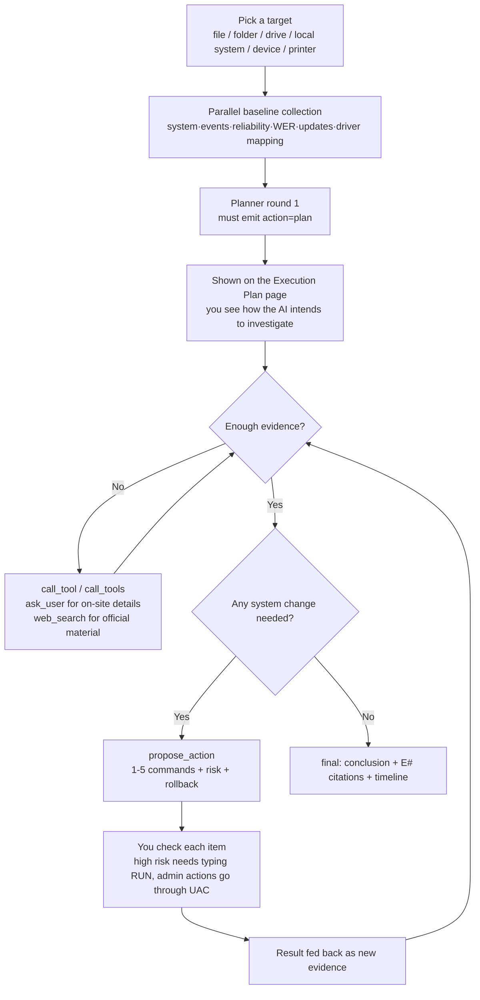

# Windows Helper Plus

English | [简体中文](README.md)

**AI that diagnoses Windows — where every conclusion carries an evidence ID, and every change waits for your click.**


---

## The problem

When Windows breaks, you have two options today.

**Guess.** Paste the stop code into a search engine, scroll to page five, read "just reinstall Windows", reinstall — and the problem comes back.

**Or hand the machine to a "one-click fix" tool.** It doesn't know which driver version you have, what the event log says, or which update landed last week. It does know how to delete registry keys.

Both paths share the same flaw: **there is no chain of evidence.**

Windows Helper Plus takes a different route. It's a native Qt desktop app that wires a DeepSeek reasoning model to 24 read-only forensic tools, so the AI investigates the way an engineer would: look at the scene, form a hypothesis, verify it, and only then act. Every conclusion must cite a real evidence ID (`E#`). Every change must show you the command and wait for you to tick the box.

It isn't "AI fixes your PC". It's **"AI works the case; you decide whether to act."**

## How it differs from pasting a stop code into a chatbot

| | Asking an AI directly | This tool |
| --- | --- | --- |
| Input | Whatever you happened to type | System, events, reliability, WER, updates, drivers, dumps — collected by 24 tools |
| Basis for conclusions | Improvised | Bound to `E#` evidence; invented IDs are rejected and the model is told to fix them |
| Method | One-shot answer | Plan first → multi-round collection → go back when evidence is thin, with no step cap |
| Before touching anything | It just tells you what to type | `propose_action` → UI lists every command, risk and rollback → you confirm |
| If it breaks something | Nothing | Automatic pre-action backup, one-click restore in Settings |

## What one diagnosis looks like



The loop has **no step limit** and never sends `max_tokens`; when the server truncates a response, the JSON is continued automatically, so a single output limit never kills a round.

## Core capabilities

### Forensics: 24 read-only tools, deep enough to actually localize the fault

System information, file/folder/project manifests, event logs, reliability records, WER reports, update history, driver enumeration (PnPUtil), signature verification (SignTool), SetupAPI logs, devices/printers/network adapters, read-only SFC/DISM scans, `wevtutil` queries, web retrieval.

Plus a bundle called `extended_diagnostics`: real print queues, the PnP device tree, PE dependency analysis, CBS logs, crash dumps, which processes hold a file, restore points, performance counters, network connectivity, and sandbox feasibility.

**PE dependency analysis** reports the target's architecture, version resources and a `dll_checks` entry per DLL, splitting anomalies into missing / architecture-mismatched / missing version info. 32-bit targets resolve from `SysWOW64` first, and API sets such as `api-ms-win-*` are never reported as missing — a spot where many tools get it wrong.

### Crash dumps: it actually runs `cdb.exe`, instead of telling you to install an analyzer

Give it a `.dmp` or let it discover one (`MEMORY.DMP`, `Minidump`, `LiveKernelReports`, WER queues, `CrashDumps`), and it runs `!analyze -v` offline, returning `bugcheck_code`, `probably_caused_by`, the stack, `failure_bucket_id` and WHEA-related details.

Analysis stays on your machine; dumps are never uploaded. Symbols are requested from Microsoft only when symbol download is enabled. Without Debugging Tools installed, the tool refuses to invent results and tells you exactly what's missing.

### Repair: back up first, act second, undo anytime

- When the AI proposes modifying, deleting or replacing something, it must declare `backup_paths` in the action (up to 8 absolute paths);
- The executor copies them to `Log/actions/<time>-<random>/backup/` before running the command and writes `backup-manifest.json`;
- **If the backup fails, the action aborts and the command never runs**;
- Restore via Settings → Restore action file backups…; directory restore deletes the current directory and copies the backup back.

It does not create system restore points automatically, and it does not roll back on failure. It tells you to create a restore point yourself. That restraint is deliberate.

### Isolated reproduction: when static analysis can't prove it, run it in a sandbox

`sandbox_control(mode=plan)` only computes policy and touches nothing. Only `mode=run` copies the target to staging (skipping `.git`/`node_modules`/`.venv`, refusing anything over 2 GB or 20,000 files), generates a launcher, starts Windows Sandbox, runs the target, collects `sandbox-result.json`, verifies host hashes, closes that sandbox and cleans up.

The host's original directory is **not mapped** into the sandbox, so only the copy can be modified. The launcher is a UTF-8 PowerShell script, so Chinese/Japanese paths don't get mangled. Even in trusted mode, this step forces a confirmation dialog.

### Local model: a context officer, never the diagnostician

`Qwen3-1.7B-Q8_0.gguf` on a llama.cpp CPU runtime (default port 8124, context 8192) organizes context, judges completeness, filters relevant case records and translates logs to Markdown.

It **does not pick tools, does not conclude, does not execute**. After receiving its JSON, the main model must re-confirm the user's goal (`plan.confirmed_user_goal` is required) and cite evidence independently. A refresh takes about 40–70 s and runs asynchronously in the background, never blocking the main flow. If the model is missing, the feature reports itself unavailable rather than fabricating output.

### Bilingual UI

Switch between Chinese and English in Settings; the current window refreshes immediately. Only UI strings are translated — **never AI text, tool output or logs**. Evidence must not be rewritten.

## Quick start

Requirements: Windows 10/11 x64, Python 3.11+ (3.12+ recommended).

```powershell
cd "<project-dir>"
.\setup.ps1
.\run.bat
```

`setup.ps1` only creates `.venv` and installs dependencies. First run:

1. Open **Settings**, enter your DeepSeek API key and save (encrypted with Windows DPAPI, decryptable only by your account);
2. Pick a target (file/folder/device/printer, or leave empty for the local system) and describe the symptoms;
3. Click **Start analysis**;
4. Watch the "Execution Plan" page to see how the AI intends to investigate; answer its questions; check each proposed command before confirming;
5. Read the "Diagnosis Conclusion" when it finishes, and use **File → Export report** to save HTML/JSON.

API key precedence: **current session → app DPAPI storage → `DEEPSEEK_API_KEY` environment variable**. A new key saved in Settings immediately overrides an old one in the environment.

### Optional: local model and context menu

```powershell
# Local Qwen (optional; the main diagnosis works without it)
# Model goes to models/Qwen3-1.7B-Q8_0.gguf, runtime to runtime/llama-b9200/
# See models/README.md and runtime/README.md

# Context menu (writes HKCU only, no admin needed)
powershell -NoProfile -ExecutionPolicy Bypass -File .\scripts\install_context_menu.ps1
```

The context menu covers 11 entries: files, all filesystem objects, folders, drives, folder background, desktop, This PC and the Printers folder. On every launch the app checks them and re-registers anything missing or pointing at an old path, so moving the project directory needs no manual fix.

## Security model

This is more than a confirmation dialog — the constraints are layered:

1. **Tool allowlist** — only registered tools can be called; arguments are validated against JSON Schema and unknown fields are rejected.
2. **Evidence closure** — `final`'s summary and every finding/cause/next_step must carry an `E#`; non-existent IDs are rejected with corrective feedback. Read-only tool calls don't require citations, so exploration isn't constrained.
3. **Actions need confirmation** — `propose_action` only produces a proposal; the UI shows the full command, risk level, admin requirement, rationale and rollback suggestion.
4. **High-risk double confirmation** — `risk=high` requires typing `RUN`.
5. **UAC isolation** — `requires_admin` actions run through a one-shot elevated runner, with output and exit code written back as evidence. A cancelled UAC is recorded as a failure; the app never silently retries.
6. **Sandbox always confirms** — copying the target, starting the sandbox and running the target require confirmation even in trusted mode.
7. **Untrusted input** — file content, event text, device names and web content are treated as data and can never alter the system prompt.
8. **Local first** — reports and records live in `%LOCALAPPDATA%\WindowsHelperPlus` by default, with no telemetry.
9. **An uploaded file isn't necessarily the broken one** — `inspect_file` returns content type and role hints, and the model must first decide whether it's a log, a screenshot, a config file or the executable under suspicion, rather than assuming it's faulty.

The default `trusted` mode lets read-only tools through, asks for medium/high-risk actions and uses UAC for admin ones. `strict` mode requires confirmation for every action.

### Optional: SYSTEM read-only broker

Some ACL/owner information is unreadable as a normal user. With the broker installed, a SYSTEM scheduled task accepts only two fixed read-only requests, `ping` and `inspect_target`, appends one `system_broker_inspect` evidence item when online and skips silently when offline. The GUI and Planner are never elevated to SYSTEM, and arbitrary commands are never handed to it.

```powershell
powershell -NoProfile -ExecutionPolicy Bypass -File .\scripts\install_system_broker.ps1
```

## Known limits

Stating these plainly is more useful than hiding them:

- The Windows 11 compact context menu shows only common items by default; use "Show more options" or `Shift+F10`.
- A standalone Shell menu on individual device/printer icons requires a COM Shell Extension. Instead, the This PC / Printers folder menus open a built-in object picker.
- `analyze_dump` depends on Debugging Tools for Windows. If the dump type doesn't match the `cdb` architecture or symbols are missing, the BugCheck may not resolve; the tool returns the failure reason and raw output so the AI can switch to event logs.
- Running a target inside the sandbox is still limited by permissions, GUI interaction and installer reboots. Driver/kernel problems and real printer/USB/PCI devices can't be fully covered by Windows Sandbox and need Hyper-V/VM or manual verification.
- **The AI's candidate causes and commands can be wrong.** Its value is putting the evidence in front of you and marking the risk — not making the judgment call for you.

## Project structure

```text
.github/workflows/      # Windows CI: install deps + run pytest
docs/                   # implementation notes
models/README.md        # where to place the local model (.gguf isn't tracked)
runtime/README.md       # llama.cpp runtime notes (binaries aren't tracked)
helper_plus/
  targets.py            # DiagnosisTarget: file/directory/drive/system/device/printer
  safety.py             # path boundaries and target validation
  core/
    orchestrator.py     # Agent–Planner–Tools main loop
    baseline.py         # parallel baseline collection, extended per target type
    validation.py       # plan/call_tool(s)/ask_user/propose_action/final protocol
    context.py          # context compression, diagnostic log, timeline
    actions.py          # confirmed cmd/powershell executor (UAC, backup/restore)
  llm/                  # DeepSeek SSE client, prompts, narration
  i18n.py               # Chinese/English UI strings (never AI text or logs)
  tools/                # 24 read-only tools (including analyze_dump)
  ui/                   # main window, execution plan page, dialogs, settings, worker
  system_broker_client.py
  reporting.py
scripts/                # context menu, SYSTEM broker, smoke scripts
tests/                  # 105 pytest tests
```

## Development and testing

```powershell
.\.venv\Scripts\python.exe -m pip install -r requirements-dev.txt
.\.venv\Scripts\python.exe -m pytest -q                          # 105 passed
.\.venv\Scripts\python.exe scripts\smoke_tools.py
.\.venv\Scripts\python.exe scripts\ui_ai_mock_smoke.py           # full UI chain on a local fake SSE, no real API
```

Tests need no real key: Planner/SSE/tool loop/plan/actions/`ask_user` are driven by a local mock server and a fake Planner, and `web_search` HTTP requests are validated against a local fake Search API.

Export logs into the project's `Log/`:

```powershell
.\.venv\Scripts\python.exe scripts\collect_logs.py
```

This assembles audit logs, full records, a summary of the latest run, Qwen-translated run Markdown, case-record archives, action backups and the symbol cache. The script only copies, never deletes, and never exports `credentials.bin` or API keys.

## License

Released under the **MIT License**, see [LICENSE](LICENSE). The local Qwen model follows the upstream Apache-2.0 license, and llama.cpp and its binaries follow their respective upstream licenses; this repository distributes neither the model nor the runtime binaries.

Provided "as is" for learning and troubleshooting assistance. AI-generated conclusions and commands may be inaccurate and cannot replace Microsoft support, professional repair or hardware diagnostics. Assess the risk, back up your data and create a restore point before changing anything.

## Contributing

Issues and pull requests are welcome. Before submitting:

```powershell
python -m pip install -r requirements-dev.txt
python -m pytest -q
```

Please don't commit `.venv/`, `models/*.gguf`, `runtime/` binaries, `Log/`, API keys, certificate private keys or local diagnostic records.

---

If this project is useful to you, a star helps more people who were told to "just reinstall Windows" find another way.
